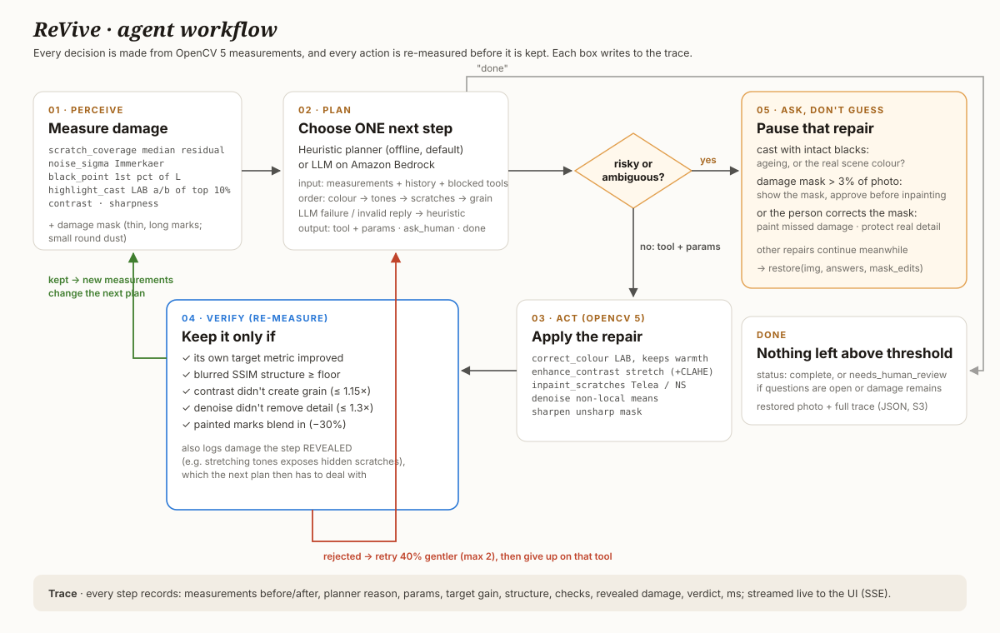
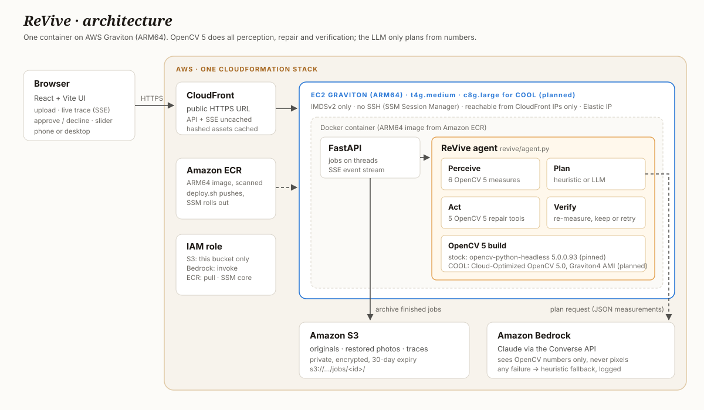
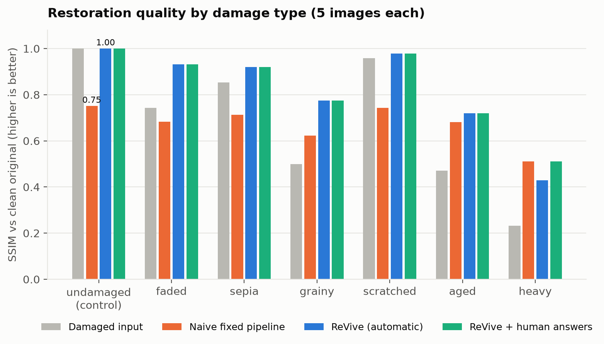
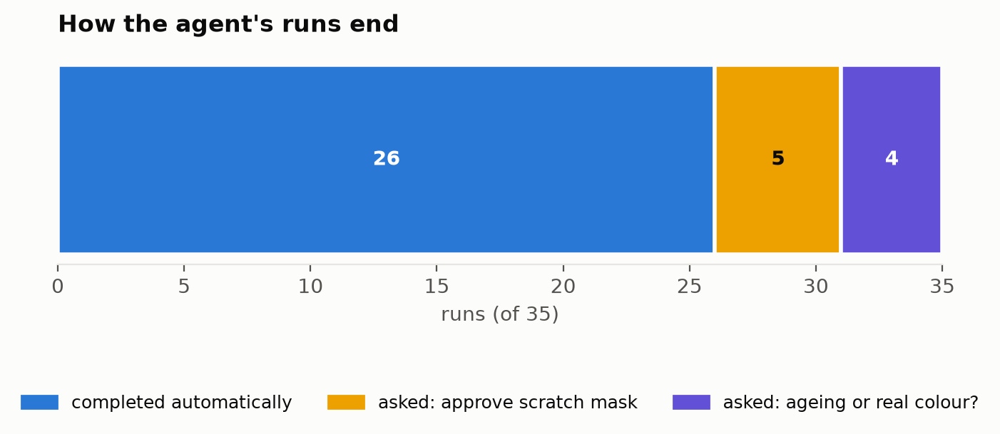
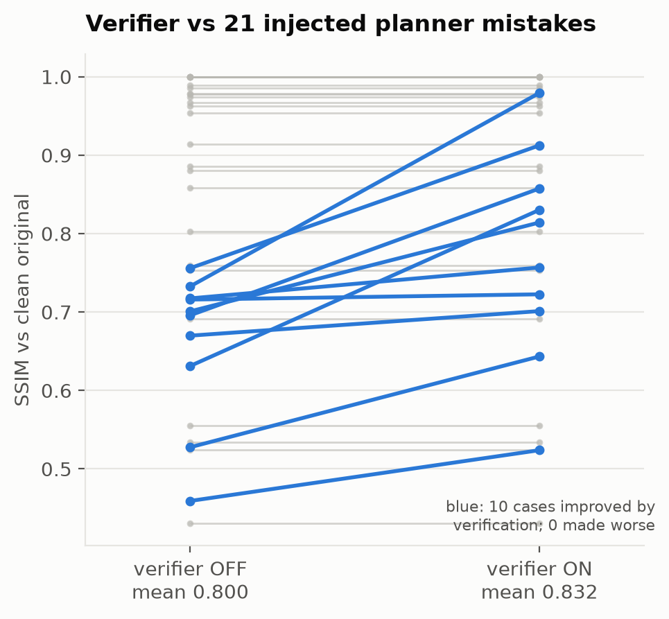
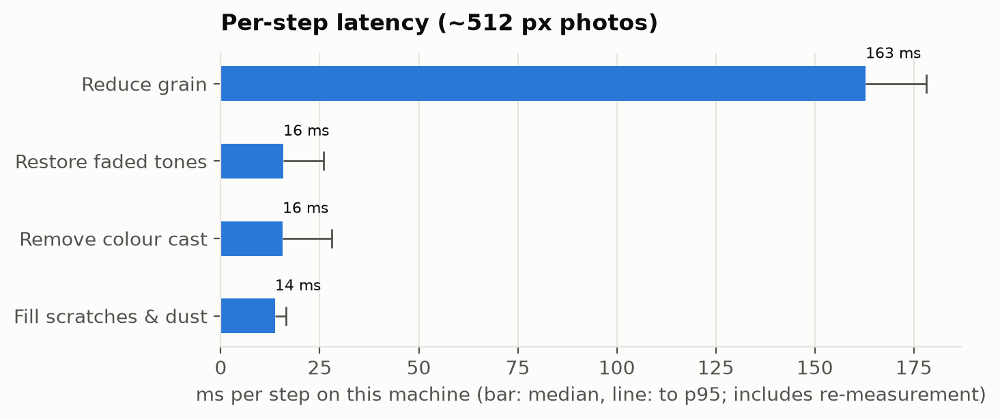

# ReVive: an OpenCV 5 agent that restores old photos and asks when it isn't sure

**OpenCV AI Competition 2026 (powered by AWS)** · Agentic Vision with OpenCV 5 · Best Use of COOL
Repository: `github.com/samaunmahmud/revive` · Live demo: **[pending: CloudFront URL]**

> Status note (draft): sections marked **[pending]** need the AWS deployment and
> the COOL benchmark run on Graviton. Every other number in this report comes
> from scripts in the repository and can be reproduced (section 9).

---

## 1. Summary

ReVive restores old, damaged photos (faded, tinted, grainy and scratched) the way
a careful human restorer would. It **measures** what is wrong with OpenCV 5,
**plans** one repair at a time, **acts** with an OpenCV 5 tool, and **re-measures**
to check that the repair helped without doing harm. When a repair could change
what the photo really shows, it **asks a person** instead of guessing.

On 35 seeded test cases (5 public-domain images × 7 damage types), ReVive raises
mean SSIM against the clean original from 0.680 (damaged) to **0.822**, where a
naive "run every filter once" pipeline drops it to 0.672. On undamaged photos
ReVive applies no steps at all (**SSIM 1.000**), while the naive pipeline drops
it to 0.75.

When a test planner injects 21 over-strong decisions, the verifier rejects the
harmful steps and recovers almost all the lost quality: mean SSIM is 0.800 with
the verifier off, **0.832** with it on, and 0.834 with no mistakes at all. Across
105 simulated LLM failures, every restoration still completed.

## 2. Problem and users

Family photo archives, local-history societies and small museums hold millions of
prints that are fading, yellowing and scratched. Restoration is skilled, slow
work, and one-click "AI enhance" tools have the opposite problem: they apply
every filter to every photo, and generative models can **invent** faces and
details, which is unacceptable for historical records.

ReVive is for people who want old photos repaired **faithfully**:
- family historians digitising albums,
- archive volunteers working through boxes of prints,
- anyone who needs to know exactly what was changed and why.

Its design rules come from how a restorer works:
1. diagnose before treating;
2. do one thing at a time;
3. check every change;
4. never invent content without permission;
5. keep a record.

## 3. How the agent works



**Perceive (`revive/perception.py`).** Six measurements, all OpenCV 5:

| measurement | method (OpenCV 5) | what it signals |
|---|---|---|
| `scratch_coverage` | `absdiff(gray, medianBlur(gray, 7))`, noise-scaled threshold, `connectedComponentsWithStats` shape rules (long and ≤ 2.5 px wide = scratch; small round = dust), `dilate`. Only **confident** marks count: those standing out ≥ 4.5× from the local texture (`blur`-based local std of the median image) | share of the photo covered by confident marks; the full mask is what gets repaired |
| `noise_sigma` | Immerkaer's estimator via `filter2D` | film grain |
| `black_point` | 1st percentile of L in `cvtColor(BGR2LAB)` | fading (lifted blacks) |
| `highlight_cast` | LAB a/b offset of the brightest 10% | ageing tint |
| `contrast`, `sharpness` | L percentile range; `Laplacian` variance | tonal range, detail |

**Plan (`revive/agent.py`).** A planner chooses **one** next step from these
numbers: a tool with parameters, `ask_human`, or `done`.
- The **heuristic planner** is deterministic, works offline, and is the fallback.
  It follows a restorer's order: colour → tones → scratches → grain.
- The **Bedrock planner** sends the measurements, the step history and the list
  of blocked tools to Claude via the Amazon Bedrock Converse API, and parses a
  JSON action.
- The LLM **never sees pixels**, so every decision is grounded in OpenCV output.
- If the model call fails, the reply isn't valid JSON, or it names an unknown or
  blocked tool, the heuristic decides that step instead, and the trace says so.

**Act (`revive/tools.py`).** Five OpenCV 5 repairs:
- `correct_colour`: LAB a/b shift that keeps a little natural warmth;
- `enhance_contrast`: percentile stretch on L, optional `createCLAHE`;
- `inpaint_scratches`: `inpaint` with `INPAINT_TELEA` or `INPAINT_NS`;
- `denoise`: `fastNlMeansDenoisingColored`;
- `sharpen`: unsharp mask with `GaussianBlur` and `addWeighted`.

**Verify.** After every action, perception runs again. A step is **kept** only if
all of these hold:
1. its own target metric improved by a minimum amount;
2. structure is preserved: SSIM on blurred greyscale (`GaussianBlur`) stays
   above a per-tool floor;
3. it passes a side-effect check that needs no clean reference:
   - **contrast must not create grain:** noise-to-tonal-range may grow at most
     1.15×. A pure fade-stretch measures about 1.0×; over-strong CLAHE measures
     1.5–2.6×.
   - **denoise must not remove detail:** the removed signal ("method noise", after
     Buades et al.) may be at most 1.3× the estimated noise.

If any check fails, the step is discarded and retried 40% gentler (at most 2
retries), and then the agent gives up on that tool. The verifier also logs damage
that a step **revealed**: stretching faded tones raises the measured grain and
scratches, and later steps then repair them.

**Ask, don't guess.** Three situations become questions instead of actions:
- a **colour cast with intact blacks** might be the real scene (coffee, sunset),
  because aged prints fade their blacks as well;
- **damage covering more than 3%** of the photo would mean inventing large areas,
  so the person sees the red damage mask and approves it first;
- **residual damage** after automatic repair is flagged for review.

The other repairs continue while a question is pending. An answer re-runs the
agent through `restore(img, answers={tool: bool})`.

**Trace.** Every step records:
- the measurements before and after,
- the planner's reason and parameters,
- the target gain, structure score and check values,
- any revealed damage,
- the verdict and the time taken.

The web UI streams these live, and the trace is downloadable as JSON.

## 4. OpenCV output changes the agent's decisions

`docs/trace-example.md` annotates three real traces. The clearest one is below.


On the "Faded portrait" sample, the scratch mask measured at the start finds
**54%** of the true scratch and dust pixels (precision 96%). These are known
exactly, because the damage is seeded. After the tone-restoration step, the
re-measured mask finds **78%** (precision 79%). Inpainting therefore uses the
new mask, and the denoise strength (10.1) is set from the re-measured grain, not
the starting 7.1. A measure-once pipeline would have missed nearly half the
scratches.

The other two examples:
- **A rejected step:** over-strong CLAHE is rejected because it created grain
  (1.56×), and the gentler retry is kept.
- **A question instead of an action:** a measured cast of 21.9 with a black
  point of 0.012 turns into a question rather than a colour correction.

## 5. Architecture and AWS deployment



| component | role |
|---|---|
| **EC2 Graviton (ARM64)** | runs one Docker container: FastAPI, the React UI and the agent. t4g.small; c8g.large with COOL **[pending]** |
| **CloudFront** | public HTTPS URL. API and Server-Sent Events uncached; hashed assets cached at the edge |
| **Amazon Bedrock** | LLM planner (Claude, Converse API) |
| **Amazon S3** | archive of every finished job (original, restored photo, trace): private, encrypted, 30-day expiry |
| **Amazon ECR** | ARM64 image, scanned on push |
| **IAM / SSM** | least-privilege instance role; administration through SSM Session Manager |

**Security.**
- The instance accepts HTTP only from CloudFront's managed prefix list.
- IMDSv2 is required.
- There is no SSH.
- Uploads are size-checked, decoded with `imdecode`, and downscaled to at most
  1600 px.

**Deployment.**
- `deploy/deploy.sh` builds the ARM64 image, pushes it to ECR, and creates or
  updates the single CloudFormation stack.
- Later releases roll out through SSM Run Command, without replacing the instance.
- `deploy/teardown.sh` removes everything.
- Running cost is about **$0.60 a day** (t4g.small).

**Deployment results [pending]:** live URL, Bedrock model and region that work on
the account, end-to-end latency through CloudFront.

## 6. Evaluation

**Setup.**
- **Images:** 5 public-domain photos from scikit-image (astronaut, coffee, cat,
  rocket, cameraman).
- **Damage profiles:** 7 seeded ones (none, faded, sepia, grainy, scratched,
  aged, heavy).
- **Scoring:** PSNR and SSIM against the clean original.
- **Baselines:** the damaged input, and a naive fixed pipeline that runs every
  tool once at default settings with no verification.
- **Simulated human:** answers truthfully. It approves masks, and says "ageing"
  only when the profile really added a tint.

### 6.1 Restoration quality

| (35 cases) | SSIM | PSNR (dB) |
|---|---|---|
| damaged input | 0.680 | 25.1 |
| naive fixed pipeline | 0.672 | 18.8 |
| **ReVive, automatic** | **0.822** | **29.4** |
| ReVive + human answers | 0.834 | 29.5 |



ReVive wins clearly on every damage type except **heavy**. There the naive
pipeline (0.51) beats automatic ReVive (0.43), and ReVive only ties it with
human approval (0.51). The agent refuses to inpaint about 10% of the photo on
its own, which is by design. Even approved, its gentler repairs leave more
damage than an aggressive filter chain. On **undamaged** photos ReVive applies
nothing at all (1.000), while the naive pipeline does visible harm (0.75).

### 6.2 Agentic behaviour (`eval/agentic.py`)

| metric | value |
|---|---|
| runs completed automatically | 26 / 35 (74%) |
| escalated to a human | 9 / 35 (5 mask approvals, 4 colour questions) |
| no harm (SSIM not lower than the damaged input) | 97% |
| task success (no harm and final damage score ≤ 1) | 83% |
| runs where re-measurement found more damage after a step | 19 / 35 (see 7) |
| inpaint steps on photos with no scratches | 0 of 10 |
| steps kept / rejected (normal planner) | 61 / 0 |



**Failure handling 1: a planner that makes mistakes.** A test planner replaced
the settings with over-strong ones on half of its first attempts:
- denoise strength ×3;
- CLAHE clip 4;
- inpaint radius 9 with Navier-Stokes;
- full-strength colour correction.

It injected 21 mistakes over the same 35 cases.

| | mean SSIM | photos not harmed |
|---|---|---|
| verifier off | 0.800 | 91.4% |
| **verifier on** | **0.832** | **97.1%** |
| reference: no mistakes | 0.834 | 97.1% |



- The verifier rejected 12 steps, and every gentler retry succeeded.
- It improved 10 cases and made none worse.
- These checks were added *because* this experiment exposed a gap. The first
  version of the verifier (target improved + structure) accepted every injected
  mistake, because each one improves its own metric. We report that openly.

**Failure handling 2: the LLM fails.** The real `BedrockPlanner` was run against
a fake client that returned broken JSON, prose, unknown tools and blocked tools,
or timed out (105 failures across 35 runs). All 35 runs completed. Every result
was pixel-identical to the heuristic planner's, and every fallback is labelled
in the trace.

**Observability.** Every decision is in the trace, with:
- the measured evidence and the planner's reason;
- parameters, target gain, structure and check values;
- revealed damage, the verdict and the time in ms.

The UI streams it live, and the JSON is stored in S3.

**Human control.**
- Risky repairs pause for approval, with the evidence shown (the red mask).
- A "decline" blocks that tool.
- Answers are recorded in the trace.

**Latency** (median per step on the evaluation photos, ~512 px, including
re-measurement):

| step | median latency |
|---|---|
| colour | 16 ms |
| tones | 16 ms |
| inpainting | 14 ms |
| denoise | 163 ms (p95 178 ms) |

Measured on an Apple M-series laptop; an earlier run on the same machine under
load measured 2–3× higher. The Graviton numbers are in 6.4.

Non-local-means denoising dominates the run time.



### 6.3 Bedrock LLM planner vs heuristic **[pending]**

`eval/planners.py` runs both planners on the same cases through the same
verifier. It records quality, escalations, fallbacks, and per-call latency and
tokens.

### 6.4 COOL vs stock OpenCV 5 on Graviton **[pending]**

`bench/benchmark.py` measures per-step latency, full-restore latency, throughput
and cost per 1,000 restores. It runs with both OpenCV builds on the same Graviton4
instance (c8g.large), plus an x86 reference. COOL is the Cloud-Optimized OpenCV
5.0 Graviton4 AMI; stock is pip `opencv-python-headless==5.0.0.93`.

A note before the numbers: stock OpenCV 5 wheels already include KleidiCV, and
denoising dominates ReVive's runtime. So any COOL gain depends on how well it
accelerates `fastNlMeansDenoisingColored`, and we will report whatever we measure.

### 6.5 Fixing false scratch detections

The first full evaluation showed that thin real detail was being flagged as
scratches: 9 of 19 kept inpainting steps were on photos with no marks (a launch
tower lattice, tripod legs, a cup rim). We separated two questions:
- **whether** to repair, decided from *confident* marks only;
- **what** to repair, using the full mask, so recall is unchanged.

A mark is confident when it stands out strongly from the texture right around it.
Per pixel, that is `|image − median| / (local std of the median image + 2)`,
averaged over the mark and required to be ≥ 4.5.

| | before | after |
|---|---|---|
| mean SSIM, automatic / with human | 0.818 / 0.830 | **0.822 / 0.834** |
| mean PSNR, automatic | 27.3 dB | **29.4 dB** |
| undamaged control | 0.994 | **1.000** |
| inpaint steps on photos with no marks | 9 of 19 | **0 of 10** |
| aged/scratched cases still repaired | 10 / 10 | 10 / 10 |

Our first version measured contrast against a ring around the whole mark. That
hid long scratches that cross many regions, and the flagship demo photo stopped
being repaired. Measuring per pixel fixed it. Cutoffs from 4.0 to 5.0 give
identical results, and 6.0 starts missing real scratches, so 4.5 sits in the
middle of that plateau.

### 6.6 What we tried that did not work

**Joining scratch fragments with `HoughLinesP`.** The idea was to recover
scratches that break up over similar tones. It found texture on clean photos
(control SSIM 0.994 → 0.991), and it slightly lowered the aged cases. It only
gained +0.004 on heavy damage, so it was not shipped.

## 7. Limitations

- **The scratch cutoff is tuned on synthetic marks.** Our seeded scratches are
  high-contrast. Faint real scratches in busy texture may not count as
  confident, and then they are not repaired. Real prints are needed to check this.
- **"Revealed" means "measured higher after this step"**, not "verified hidden
  damage". 6 of the 8 "revealed scratches" events happen on photos with no marks.
  Since 6.5 they no longer trigger a repair, but the badge still appears in the
  trace.
- **Denoising softens texture** (wood grain, fur) while still passing the
  verifier.
- **Heavy damage:** the conservative agent restores less than an aggressive
  filter chain, even with approval.
- **Warm subjects under a tint** are slightly over-corrected.
- **Synthetic damage only.** No real scanned prints have been evaluated yet.
- **Overfitting risk.** The verifier limits (1.15×, 1.3×) and the perception
  thresholds were tuned on the same five images we evaluate on. A held-out set of
  real prints is needed.

## 8. Responsible use

- **ReVive repairs; it does not invent.** It uses classical OpenCV operations
  only. There is no generative fill and no face synthesis.
- **Large-area inpainting and ambiguous colour changes need human approval.**
- **Every change is logged with its evidence,** and the trace travels with the
  result.
- **Restored images should be labelled as restored** when used as historical
  records. The trace JSON documents what was changed.
- **Uploads are processed privately** and archived in a private S3 bucket that
  deletes them after 30 days.
- **No photo is used for training.**
- **The LLM receives six numbers and a step history, never the image.**

## 9. Reproducing the results

```bash
pip install -r requirements.txt
python -m eval.evaluate        # quality table (6.1)
python -m eval.agentic         # agentic metrics, verifier ablation, LLM-failure test (6.2)
python -m eval.trace_example   # annotated trace and ground-truth mask numbers (4)
python -m eval.charts          # figures in docs/figures
python -m eval.planners        # Bedrock vs heuristic (needs AWS credentials)
python -m bench.benchmark run --label stock   # COOL benchmark (run on Graviton)
```

Pinned dependencies are in `requirements.txt`; the ARM64 container is `Dockerfile`.
