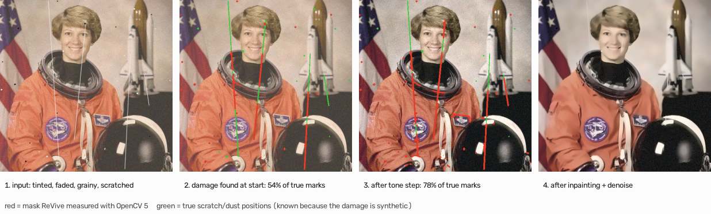

# Annotated traces: OpenCV output changing the agent's next decision

Every number below comes from a real run (`python -m eval.trace_example`,
`python -m eval.agentic`). You can reproduce the first and third in the web app
by clicking the **Faded portrait** and **Warm café table** samples.

## 1. Re-measurement changes what gets repaired (Faded portrait)

| step | planner's reason (from OpenCV numbers) | verifier | what the re-measurement changed |
|---|---|---|---|
| 0 | perceive: `highlight_cast 13.6`, `black_point 0.239`, `noise_sigma 7.1`, `scratch_coverage 0.89%` | | starting plan: colour, then tones |
| 1 `correct_colour` 0.9 | "cast 13.58 with faded blacks (0.239) = ageing tint" | kept: cast 13.6 → 8.3, structure 0.999 | nothing new |
| 2 `enhance_contrast` clip 0 | "black_point 0.239 > 0.15: blacks faded" | kept: black point → 0.024; **noise growth 1.00×**, so the extra grain is revealed, not created | **revealed:** grain 7.1 → 10.3 and scratches 0.89% → 1.78% |
| 3 `inpaint_scratches` | "scratch_coverage 0.0178 > 0.0045" | kept: coverage → 0.02% | uses the **new** mask |
| 4 `denoise` 10.1 | "noise_sigma 10.13 > 6.0" (strength set from the re-measured grain, not the starting 7.1) | kept: method noise 0.91× (removed about the estimated grain, not detail) | |

**Why it matters.** The damage is synthetic and seeded, so the true scratch
and dust positions are known (green in the figure).

| | mask size | precision (on real marks) | recall (real marks found) |
|---|---|---|---|
| mask measured at the start | 0.89% | 96% | **54%** |
| mask re-measured after the tone step | 1.78% | 79% | **78%** |

A fixed pipeline that measured once and then ran every tool would have
inpainted with the first mask and missed almost half of the real scratches. The
agent re-measures after each step, so step 3 repairs what step 2 made visible.
Step 4's strength also comes from the re-measured grain (10.1, not 7.1).

## 2. The verifier rejects a harmful step, and the retry succeeds

From the verifier ablation (`eval/agentic.py`), where a test planner injects
over-strong settings. Case: astronaut, faded.

| step | action | verifier |
|---|---|---|
| 1 | `enhance_contrast` clip 4.0 *(injected mistake)* | **rejected**: "created grain: noise grew 1.56× relative to the tones (max 1.15)". Its own target improved (black point fixed), so the old check would have kept it |
| 2 | `enhance_contrast` clip 0.6 (gentler retry) | kept: noise growth 1.05× |
| 3 | `inpaint_scratches` | kept |

Across 35 cases, the planner injected 29 mistakes. With the verifier on, mean SSIM was 0.827 (no mistakes: 0.830).
With it off, mean SSIM was 0.797. It helped in 10 cases and made none worse.

## 3. A measurement turns into a question instead of an action (Warm café table)

Perception reports `highlight_cast 21.9` with `black_point 0.012`. Aged prints
fade their blacks as well as tinting their highlights. Here the blacks are
intact, so the tint may be the real colour of the scene (coffee, wood). The
planner does **not** correct it. It pauses that repair and asks the person,
showing the measured evidence. The other repairs (grain, dust) carry on. The
answer re-runs the agent with `restore(img, answers={"correct_colour": …})`.

## Honest notes

- In the first example the starting measurement already called for inpainting.
  What the re-measurement changed was **what** got inpainted (the mask) and the
  denoise strength.
- On profiles that add no scratches, the same re-measurement sometimes flags
  thin real detail (tower lattice, tripod legs, a cup rim) as "revealed
  scratches", and the agent inpaints it. This is a known false positive, listed
  in the report's limitations. We swapped out a demo sample whose description
  depended on it.
